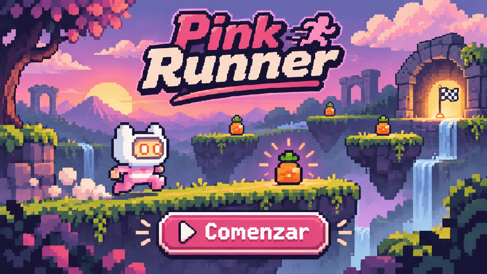
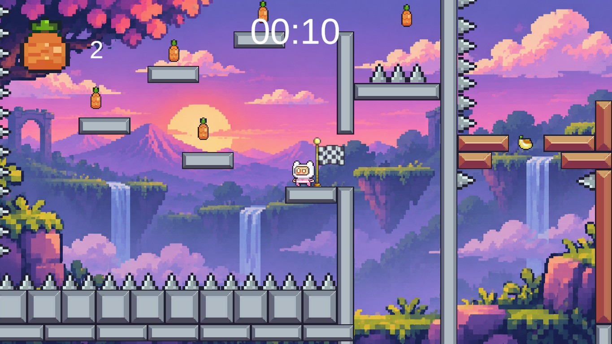
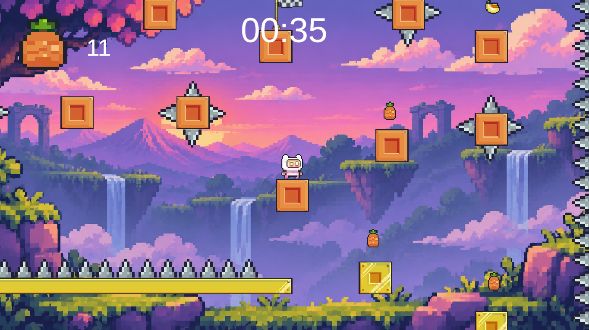
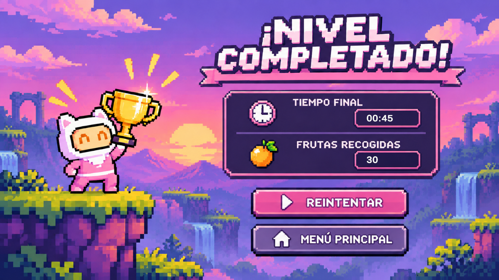

# Pink Runner

**Autor:** Jaime Beres Amenedo  

## Descripción

Pink Runner es un videojuego de plataformas en 2D en el que controlas a PinkMan, quien debe alcanzar el trofeo final en el menor tiempo posible y con la mayor cantidad de frutas que pueda. Estas frutas se van sumando al contador y se guardan cada vez que llegas a un punto de control, pero ojo!! Si te mueres antes de llegar al siguiente punto perderás las frutas acumuladas desde el punto anterior y no podras volver a recogerlas, por lo que debes pensártelo bien antes de asumir riesgos.

## Características

- Movimiento lateral y salto con físicas 2D.
- Animaciones del personaje: reposo, carrera, salto y muerte, entre otras.
- Doble salto y mecánicas de movimiento con las paredes.
- Frutas coleccionables y contador de unidades recogidas.
- Checkpoints para reaparecer al morir.
- Obstáculos y zonas peligrosas que requieren controlar los saltos y el movimiento.
- Cronómetro de partida.
- Pantalla de victoria con el tiempo y las frutas conseguidas.
- Música de fondo y efecto de sonido al saltar.

## Controles

| Acción | Tecla o control |
|---|---|
| Moverse | W, A, S, D o bien las flechas |
| Saltar | Espacio |
| Doble salto | Doble espacio |

## Capturas

### Pantalla de inicio

### Nivel 1

### Pantalla final

